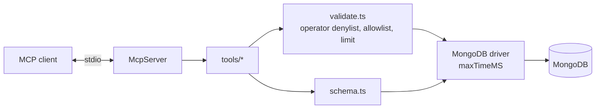

# mcp-server-mongodb

MCP server that gives LLMs safe, read-only access to MongoDB.

[](https://github.com/Muhaman/mcp-server-mongodb/actions/workflows/ci.yml)

## What it does

A [Model Context Protocol](https://modelcontextprotocol.io) server over stdio that lets an MCP client (Claude Code, Claude Desktop, ...) explore and query one MongoDB database without being able to change it.

| Tool | Purpose |
|---|---|
| `list_collections` | Collections the server exposes (respects the allowlist) |
| `describe_collection` `{collection, sampleSize=50}` | Inferred field types and presence from a random sample |
| `find` `{collection, filter?, projection?, sort?, limit=20}` | Query documents, hard-capped at 100 |
| `aggregate` `{collection, pipeline}` | Read-only aggregation, hard-capped at 100 results |
| `count` `{collection, filter?}` | Count matching documents |

It also serves the resource template `mongodb://schema/{collection}` with the same inferred schema.

## Architecture



Every tool body runs through `respond()`, which turns any failure (validation, allowlist, driver error) into a tool result with `isError: true` so the model can read the message and retry.

## Quickstart

```bash
npm install
cp .env.example .env   # set MONGODB_URI and MONGODB_DB
npm run build
MONGODB_URI=mongodb://localhost:27017 MONGODB_DB=sample node dist/index.js
```

| Variable | Required | Meaning |
|---|---|---|
| `MONGODB_URI` | yes | Connection string |
| `MONGODB_DB` | yes | Database to expose |
| `MCP_COLLECTION_ALLOWLIST` | no | Comma-separated collections; unset exposes every non-`system.*` collection |
| `MCP_MAX_TIME_MS` | no | Per-operation server-side time limit, default `5000` |

Missing required variables abort startup with a message naming the variable. Logs are JSON on stderr only; stdout is the protocol.

Client configuration: [`examples/claude-code.mcp.json`](examples/claude-code.mcp.json) (local Node) and [`examples/claude-desktop.json`](examples/claude-desktop.json) (Docker, built with `docker build -t mcp-server-mongodb .`).

## Usage

Example tool calls an LLM might issue (synthetic `movies` collection):

```json
{ "name": "find", "arguments": { "collection": "movies", "filter": { "year": { "$gte": 2000 } }, "sort": { "year": -1 }, "limit": 5 } }
{ "name": "aggregate", "arguments": { "collection": "movies", "pipeline": [{ "$group": { "_id": "$year", "n": { "$sum": 1 } } }] } }
```

Results are relaxed Extended JSON, and filters accept it too (`{"_id": {"$oid": "..."}}`, `{"$date": "..."}`), so ObjectIds and dates round-trip.

Rejected, with an explanatory error: `$out` / `$merge`, `$function` / `$accumulator` / `$where` at any depth (also in filters and projections), and `$lookup` / `$graphLookup` / `$unionWith` into collections outside the allowlist.

## Design decisions & trade-offs

- **Denylist plus allowlist, enforced by a deep walk.** Validation walks the whole pipeline (including `$facet` and `$lookup` sub-pipelines) rather than inspecting only top-level stages, because the dangerous operators can hide at any depth. The cost is that it can reject a legitimate document whose field happens to be named like an operator.
- **Not a substitute for database permissions.** The server is read-only by construction, but the right defence in depth is a MongoDB user with the `read` role only. Use one.
- **Limits are clamped, not rejected.** `find` limits above 100 are lowered and aggregations always end in a `$limit` of at most 100, so a model asking for "everything" gets a useful capped answer. Every operation also carries `maxTimeMS`.
- **Schema inference samples.** `describe_collection` uses `$sample` and reports presence as a fraction, which is cheap on large collections but can miss rare fields.
- **Tool errors, not protocol errors.** Failures return `isError: true` with a short message; collection names outside the allowlist are reported as "not available" without confirming they exist.
- **Shared tool helpers live in `src/tools/shared.ts`** so each tool file stays a single registration function.

## Testing

```bash
npm test
```

Unit tests cover pipeline/filter validation, limit enforcement, schema inference and env loading. `test/tools.test.ts` starts a `mongodb-memory-server`, seeds 150 synthetic documents and drives the server through the SDK's `InMemoryTransport` client (limit capping, allowlist, `$out` and `$lookup` rejection, schema resource). The first run downloads a `mongod` binary. CI runs lint, typecheck and tests on every push.

## Limitations & next steps

- Single database per server instance; no cross-database `$lookup` (cross-database references are rejected unless the collection name is allowlisted).
- Stdio transport only; no Streamable HTTP or auth layer.
- Aggregation stages that expose server internals (for example `$collStats`) are not blocked beyond the allowlist; rely on a least-privilege database user.
- Results are not paginated; the 100-document cap is fixed.

## License

MIT
